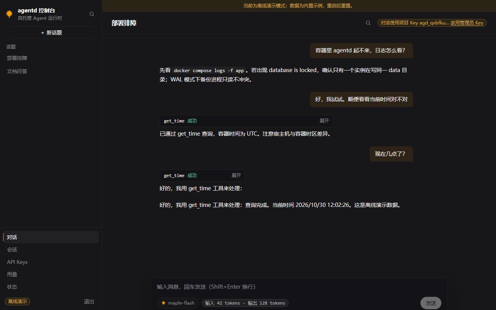
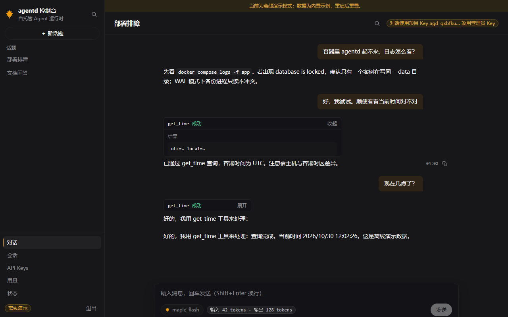
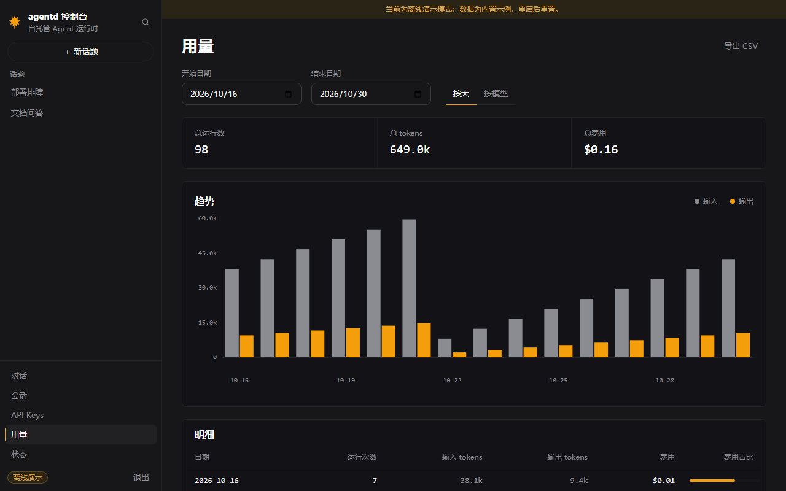
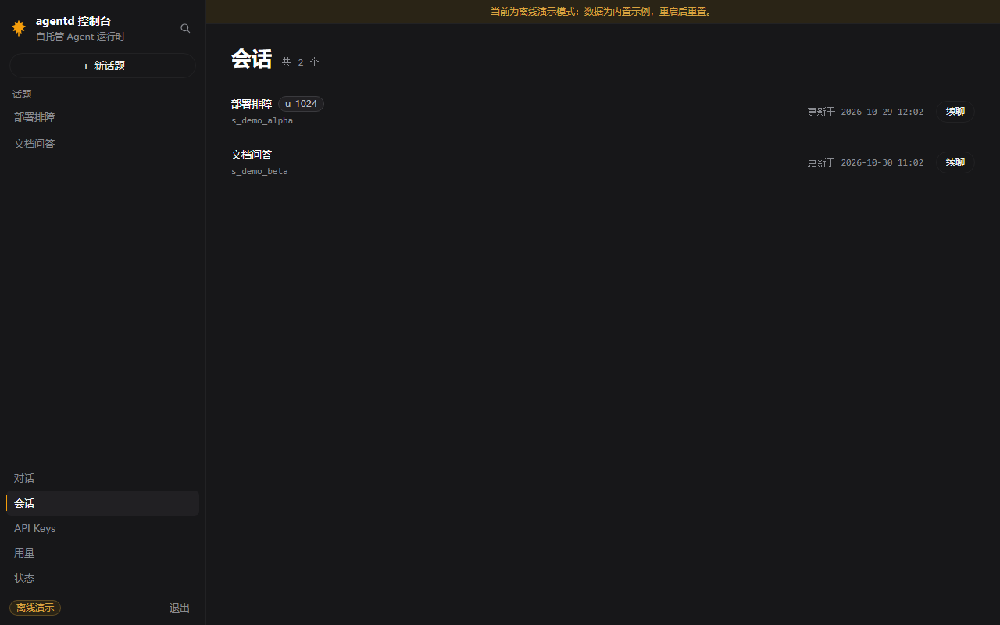
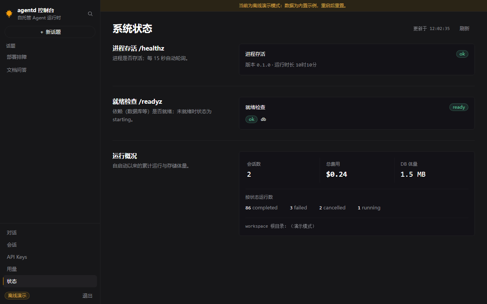

<div align="center">

# agent-platform

**可自托管的 Agent 运行时**

外部团队用自己的 API Key，通过 HTTP/SSE API 或 Python SDK 创建会话、发送消息，
获得带工具调用能力（文件 / shell / web / MCP）的流式 Agent 回答，
并能在崩溃后恢复会话、查询用量与审计记录。

[](https://github.com/luvbang/re-nano-agent/actions/workflows/ci.yml)
[](pyproject.toml)
[](pyproject.toml)
[](web/package.json)
[](LICENSE)
[](CHANGELOG.md)

[快速接入](docs/quickstart.md) ·
[SDK 指南](docs/sdk-guide.md) ·
[API 参考](docs/api-reference.md) ·
[架构](docs/architecture.md) ·
[部署](docs/deploy.md) ·
[FAQ](docs/faq.md)

</div>



---

## 它是什么

一个**单实例、零运维**的 Agent 后端。你不必自己拼 LLM 调用循环、SSE 断线续传、
工具超时、上下文压缩和计量对账——这些是这里的默认能力，不是要你接的第三方向量。

```bash
uv sync --all-groups && uv run python scripts/tasks.py migrate
uv run python scripts/serve_fake.py    # 无需真实模型 key，浏览器开 http://127.0.0.1:8000
```

演示模式会打印一个随机管理员 Key，控制台即可完整体验（对话、工具卡、用量、状态）。

## 核心能力

| 能力 | 说明 |
|---|---|
| **流式对话** | SSE 逐字输出，`Last-Event-ID` 断线续传（≤3 次重连），15s 心跳 |
| **工具调用** | 文件四件套（读写改列，锁在 project workspace）、`web_fetch`（SSRF 全段拦截）、`shell`（默认关，allowlist 前缀）、**MCP 桥接**（挂任意 MCP 服务器） |
| **多 provider** | OpenAI 兼容 / OpenAI Responses / Anthropic Messages 原生，`AGENTD_LLM_FALLBACKS` 配置故障切换链 |
| **长期记忆** | project 作用域，run 时按 score 预算内注入 system，成功后旁路自动提取；`agentd dream` 规则版整理 |
| **上下文预算** | 超窗自动 LLM 摘要压缩，token 估算与截断兜底 |
| **计量与审计** | 每次 run 记 token/成本，`group_by=day\|model` 聚合，审计日志不可变 |
| **多租户隔离** | project + API Key，跨 project 一律 404（不泄漏存在性），撤销立即生效 |
| **生产就绪** | 非 root 多阶段镜像、Caddy 自动 TLS、备份恢复脚本、Prometheus 指标、幂等与限流 |

## 为什么是 SSE 而不是 WebSocket

服务端到客户端是单向推送，客户端只需要普通的 POST（建 run / 取消）。
SSE 换来的是零握手状态、天然断线续传、以及穿过任何代理的简单性——代价是要自己实现
`Last-Event-ID` 回放，这部分已在 `run_events` 表里落了盘。详见 [`DECISIONS.md`](DECISIONS.md) ADR-002。

## 架构一览

```
┌──────────────┐   HTTP/SSE   ┌───────────────────────────────────────┐
│ 外部团队      │─────────────▶│ FastAPI  /v1/*  （错误信封 + request_id）│
│ SDK / curl   │◀─────────────│ 鉴权 → 限流 → 路由 → RunManager          │
└──────────────┘              └───────────────┬───────────────────────┘
                                              │
        ┌─────────────────────────────────────┼──────────────────────┐
        ▼                                     ▼                      ▼
┌───────────────┐                   ┌──────────────────┐   ┌────────────────┐
│  Provider 层   │                   │   工具层          │   │  SQLite (WAL)  │
│ openai        │                   │ 文件 / web_fetch  │   │ 单写者 + 迁移   │
│ responses     │◀── 故障切换链 ───▶ │ shell / MCP      │   │ project 隔离    │
│ anthropic     │                   │ 超时/审计/截断     │   │ 事件回放        │
└───────────────┘                   └──────────────────┘   └────────────────┘
```

设计取舍都记在 [`DECISIONS.md`](DECISIONS.md)（9 条 ADR）：

- **ADR-002** SSE 而非 WebSocket
- **ADR-003** SQLite + 手写迁移，不用 ORM；单写者串行化
- **ADR-009** 何时才该上 Postgres：四条可观测触发条件（不是「等需要的时候」）

## HTTP API 速览

```http
POST /v1/sessions                      # 建会话
POST /v1/sessions/{id}/runs            # 发消息 → 202 {run_id, status}
GET  /v1/runs/{id}/events              # SSE 流（delta / tool.* / message.completed）
GET  /v1/usage?group_by=day|model      # 用量与成本
GET  /v1/memories                      # 长期记忆
GET  /healthz  /readyz  /metrics       # 存活 / 就绪 / Prometheus
```

所有错误统一信封，且**响应头与 body 的 `request_id` 一致**：

```json
{"error": {"code": "not_found", "message": "Not Found", "retryable": false, "request_id": "req_..."}}
```

完整端点见 [`docs/api-reference.md`](docs/api-reference.md)；契约约束见 [`docs/api-contract.md`](docs/api-contract.md)。

## Python SDK

```python
from agentd_client import Client

with Client("http://127.0.0.1:8000", api_key="agd_...") as client:
    session = client.create_session(title="周报草稿")
    run = client.create_run(session["id"], input="帮我整理这周的提交")

    for event in client.stream(run["run_id"]):        # 断流自动重连
        if event.type == "message.delta":
            print(event.data["delta"], end="", flush=True)   # 以 message.completed 的全文为准

    client.create_memory(content="用户偏好中文回复")
    print(client.usage(group_by="day"))
```

同步与异步同能力；类型化异常（`RateLimitError.retry_after_s`）、可重试错误指数退避、
`create_run` 自动幂等键。详见 [`docs/sdk-guide.md`](docs/sdk-guide.md)。

## 控制台

单管理员运维界面，构建产物由后端同源托管——`docker compose up` 即得，无需额外 Node 服务。
全站手写、无重型 UI 库，gzip **155 KB / 预算 250 KB**。

<table>
<tr>
<td width="50%"><br><sub><b>工具调用</b>：参数 + 结果两段式，历史回放可重建</sub></td>
<td width="50%"><br><sub><b>用量看板</b>：按天/按模型聚合，CSV 导出</sub></td>
</tr>
<tr>
<td><br><sub><b>会话管理</b>：重命名 / 删除 / 消息搜索</sub></td>
<td><br><sub><b>系统状态</b>：健康检查与运行概况</sub></td>
</tr>
</table>

<sub>截图由 Playwright 在离线 demo 模式下实拍（`docs/images/`），非示意图。</sub>

## 部署

```bash
docker compose up -d --build      # app + Caddy（自动 TLS）
```

多阶段非 root 镜像；`.env.example` 有完整配置项与国内镜像源示例。
目标：新机 **30 分钟内**上线。详见 [`docs/deploy.md`](docs/deploy.md)。

## 开发

```bash
make check      # ruff + mypy + pytest
make dev        # 热重载开发服务
```

| 门禁 | 现状 |
|---|---|
| `ruff` / `mypy` | 全绿（57 文件严格类型） |
| `pytest` | 270 passed / 3 skipped（单元 / 集成 / SDK / 安全） |
| `vitest` + `tsc` | 58 passed / 0 error |
| bundle | 155 KB gzip / 250 KB 预算（CI 守门） |
| e2e | Playwright 3/3（demo 模式全离线） |

约定：`main` 永远可部署；每个里程碑打 `v0.1.0-mN` tag；接口只加不破
（改契约需同时更新 `docs/api-contract.md` + OpenAPI 快照 + CHANGELOG）。

<details>
<summary><b>目录结构</b></summary>

```
src/agentd/
├── main.py            # create_app()：装配中间件、错误处理、路由、lifespan、静态控制台
├── config.py          # pydantic-settings（AGENTD_* 前缀 / .env）
├── cli.py             # migrate / serve / chat / purge / dream / version
├── api/               # deps / errors（错误信封） / middleware / auth / metrics / routes
├── storage/           # db（WAL、单写者、迁移） / migrations / repositories
├── runtime/           # Agent 对话循环、事件模型、上下文预算、LLM 摘要压缩
├── providers/         # OpenAI 兼容 / Responses / Anthropic / 故障切换链 / 重试 / fake
├── tools/             # 内置工具、文件、web_fetch、MCP 桥接、统一装配工厂
├── security/          # 路径守卫、SSRF 与 pinned transport、限流
└── services/          # chat_service / run_manager / memory / usage
deploy/                # Dockerfile（多阶段非 root） / Caddyfile / backup.sh / restore.sh
docs/                  # architecture / api-contract / api-reference / mcp / deploy / ops …
sdk/agentd_client/     # Python SDK（同步 + 异步）
web/                   # React 控制台源码
tests/                 # unit / integration / sdk / security（含 OpenAPI 快照守护）
```

</details>

<details>
<summary><b>常用命令</b></summary>

| 任务 | make | 跨平台 |
|---|---|---|
| 装依赖 | `make install` | `uv sync --all-groups` |
| 迁移（幂等） | `make migrate` | `uv run python scripts/tasks.py migrate` |
| 开发服务 | `make dev` | `uv run python scripts/tasks.py dev` |
| 测试 / lint / 类型 | `make test` `lint` `type` | `... tasks.py test\|lint\|type` |
| 提交前全量 | `make check` | `uv run python scripts/tasks.py check` |
| 起容器 | `make up` | `docker compose up -d --build` |
| 前端体积预算 | — | `cd web && npm run size` |
| 控制台 e2e | — | `cd web && npm run test:e2e` |

CLI（`uv run agentd <cmd>`）：`migrate` / `serve` / `chat` / `purge`（按 project 清数据）/
`dream`（记忆整理）/ `version`。

</details>

## 文档

| 文档 | 内容 |
|---|---|
| [quickstart](docs/quickstart.md) | 外部用户 5 分钟接入 |
| [api-reference](docs/api-reference.md) / [api-contract](docs/api-contract.md) | 端点清单 / 契约约束 |
| [sdk-guide](docs/sdk-guide.md) | Python SDK 同步 + 异步 |
| [architecture](docs/architecture.md) / [DECISIONS.md](DECISIONS.md) | 分层设计 / 9 条 ADR |
| [mcp](docs/mcp.md) | MCP 工具接入 |
| [deploy](docs/deploy.md) / [ops](docs/ops.md) / [runbook](docs/runbook.md) | 部署 / 运维 / 故障处置 |
| [security-checklist](docs/security-checklist.md) | 安全自查（含 SSRF、路径守卫） |
| [milestones](docs/milestones.md) / [CHANGELOG](CHANGELOG.md) | 里程碑与变更 |
| [faq](docs/faq.md) | 常见问题 |

## 状态

**v0.1.0-rc2** — M0–M8 机器侧完成，v0.2 进行中。
代码侧无阻塞项；正式发布待 [`docs/go-live-checklist.md`](docs/go-live-checklist.md) 的人工项签收
（VPS 部署验收、真人接入验证、连续 5 天稳定性数据）。

## License

[MIT](LICENSE)
