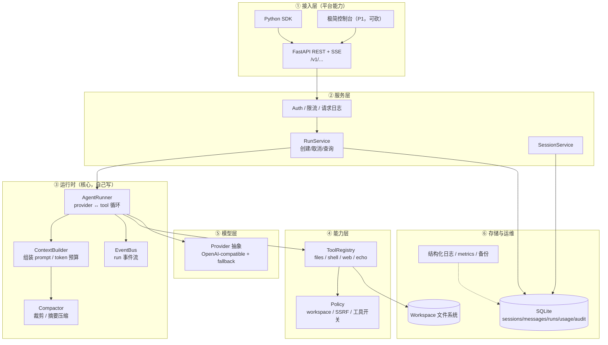
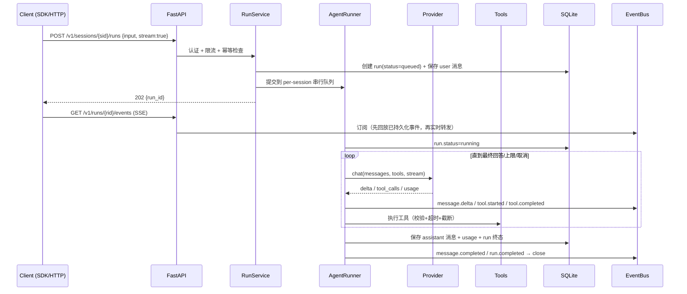

# 架构（v0.1）

> 参考 nanobot 的架构思想（小核心、单一状态所有者、typed event、分层持久化），从零实现、按 v0.1 范围裁剪。

## 1. 分层



## 2. 目录结构

```text
agent-platform/
├── pyproject.toml                # uv / ruff / mypy / pytest 配置
├── Makefile                      # dev / test / lint / type / migrate / deploy
├── scripts/tasks.py              # Makefile 的跨平台等价实现（Windows 无 make 时用）
├── docker-compose.yml
├── deploy/
│   ├── Dockerfile                # 多阶段、非 root
│   └── Caddyfile                 # 自动 HTTPS + 反代（SSE 直通）
├── src/agentd/
│   ├── main.py                   # FastAPI app 装配（create_app）
│   ├── config.py                 # pydantic-settings
│   ├── log.py                    # JSON 结构化日志 + request_id/run_id 上下文
│   ├── cli.py                    # migrate / serve / version
│   ├── api/
│   │   ├── routes/health.py      # /healthz /readyz
│   │   ├── deps.py               # 依赖注入（db、settings）
│   │   ├── errors.py             # 统一错误信封 + 异常处理器
│   │   ├── middleware.py         # request-id 中间件（纯 ASGI）
│   │   └── schemas.py
│   ├── runtime/                  # M1：runner / events / context / compaction
│   ├── providers/                # M1：base 协议 + openai_compat
│   ├── tools/                    # M2：base / registry / filesystem / shell / web
│   ├── security/                 # M2：paths / ssrf / ratelimit
│   ├── storage/
│   │   ├── db.py                 # 连接 / WAL / 单写者 / 迁移 runner
│   │   ├── migrations/001_init.sql
│   │   └── repositories.py
│   └── services/                 # M3+：run_service / session_service / usage_service
├── sdk/agentd_client/            # M4：Python SDK
├── tests/{unit,integration,security,fixtures}/
├── examples/                     # M4/M6
├── docs/                         # architecture / api-contract / deploy
└── V0.1-SCOPE.md
```

## 3. 一次 run 的生命周期（v0.1 定稿）



相对 nanobot 的简化：

- 没有 `MessageBus`（不需要多通道复用），run 事件直接进 EventBus + SSE。
- 没有 7 阶段流水线，只有 `prepare → loop → persist`。
- 不做 mid-turn 注入（v0.2 再加）。
- `/stop` 通过取消 asyncio task 实现。

## 4. 状态机

```text
queued → running → completed | failed | cancelled | interrupted
```

- 启动时把所有 `running` 改成 `interrupted`（崩溃恢复）。
- `interrupted` 的 run 不可续跑；客户端发起新一轮 run 继续对话。

## 5. 数据模型（SQLite，schema v1）

见 `src/agentd/storage/migrations/001_init.sql`，实体：

```sql
projects(id, name, workspace_path, created_at)
api_keys(id, project_id, key_hash, key_prefix, name, scopes, rate_limit_per_min, revoked_at, created_at)
sessions(id, project_id, external_user_id, title, metadata_json, created_at, updated_at)
messages(id, session_id, seq, role, content_json, tool_calls_json, tool_call_id, meta_json, created_at)
runs(id, session_id, project_id, status, model, input_tokens, output_tokens, cost_usd, error_json, started_at, finished_at)
run_events(id, run_id, seq, type, payload_json, created_at)   -- 仅控制类事件（delta 不入库）
tool_calls(id, run_id, tool_call_id, name, args_json, result_preview, status, duration_ms, created_at)
usage_records(id, project_id, run_id, model, input_tokens, output_tokens, cached_tokens, cost_usd, created_at)
audit_logs(id, project_id, actor, action, target, detail_json, ip, created_at)
schema_version(version, applied_at)
```

设计约束：

- **模型历史 vs 展示/事件历史分离**：`messages` 是模型回放的真相；`run_events` 只服务 SSE 回放与 UI，不进 prompt。
- **单一写入者**：所有 SQLite 写操作走同一把 `asyncio.Lock` + `asyncio.to_thread`，避免 `database is locked`。
- **状态机显式**：启动时把 `running` 收敛为 `interrupted`。
- **金额/用量单独表**：永远不在 `messages` 里塞统计字段。
- **多项目隔离**：所有查询强制带 `project_id`。
