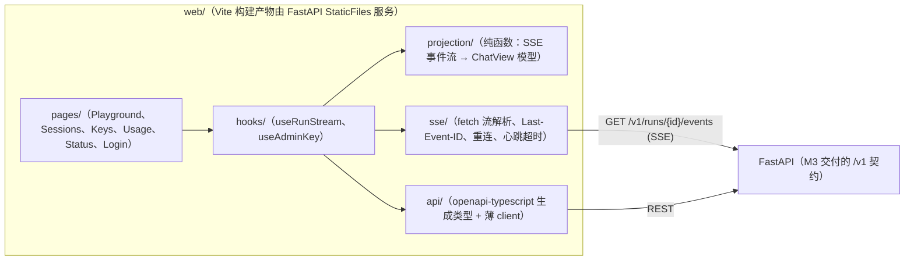

# Web 控制台前端架构（M6，P1）

> 状态：设计冻结待评审（2026-10-24，M1 完成后编写；实现排期在 M6 D1–D3，M5 末有砍单决策点）。
> 定位：自托管单管理员的运维/演示控制台，**不是**对外产品的前端。平台能力的第一交付物始终是 HTTP/SSE API + SDK（`docs/api-contract.md`）。
> 参考对象：nanobot WebUI（`nanobot/webui/`，Vite + React 18 + TS + Tailwind 3 + shadcn/ui）——同栈但砍掉其复杂度，对照表见 §2。
> v0.2 现状差异：实际实现**未引入** shadcn/ui 与 Radix（见 §3），图表也从 recharts 换成手写 SVG。

## 1. 范围

**做（M6 三天）**

- 登录：管理员 API Key（`Authorization: Bearer`），无用户体系。
- Playground：选/建 session → 发消息 → SSE 流式渲染（delta 逐字、工具调用折叠卡、usage 摘要、失败条）。
- Sessions 列表：分页、进入续聊（读 `GET /v1/sessions/{id}/messages` 重建历史）。
- API Keys 管理：创建（一次性展示完整 key）/ 撤销。
- Usage：按天/模型聚合图表（消费 `GET /v1/usage`）。
- 系统状态：`/healthz` `/readyz` + 当前并发/今日 run 数（若有端点，M4 补）。

**不做（防 scope creep，同 ROADMAP §1.4）**

- ❌ 多栏/多标签工作台、文件预览/编辑器、diff 视图 → v0.2+
- ❌ 多语言 i18n（v0.1 中文一档；文案集中在 `src/lib/copy.ts` 留切换余地）
- ❌ WebSocket / 实时推送多个 run 的全局活动流（v0.1 只有"我订阅的 run"）
- ❌ 移动端专门适配（响应式到平板宽度即可，M6 D3 DoD 原文即"基本可用"）
- ❌ 前端侧乐观更新/离线缓存（服务器状态以 TanStack Query 缓存为准）

> v0.2 追加：原本列为「不做」的**移动端专门适配**已做——宽度 <1024px 时侧栏折叠为
> 顶栏 + 全屏抽屉（`components/Layout.tsx`）。仍不做多栏工作台、文件编辑器、diff 视图、
> i18n、WebSocket 全局活动流与前端乐观更新。

## 2. 该抄 nanobot WebUI 的 vs 不抄的

| ✅ 抄（思想或工具） | 为什么 | ❌ 不抄 | 为什么 |
|---|---|---|---|
| Vite + React 18 + TypeScript + Tailwind（**shadcn/ui 未采纳**，见 §3） | 经验直接迁移；栈同代、单人可维护的甜点位 | React 19 / Next.js / SSR | 纯内部静态控制台，SSR/路由服务化是负资产 |
| 构建产物由后端静态服务（同源） | 用户 `docker compose up` 即得控制台，零 Node 依赖；同源免 CORS | 前端独立部署/独立域名 | 多一个部署面，违背"一条命令部署" |
| dev 模式 Vite proxy 到后端端口 | HMR 开发体验与生产同源行为一致 | `nanobot webui --dev` 式的进程托管 | 我们后端启动足够简单，两条命令即可 |
| 投影函数纯函数化 + vitest | 事件流逻辑是前端最容易坏的地方，纯函数最好测 | 30+ 模块的 `lib/`（canonical-run-snapshot、client-run-ledger、markdown-streaming-blocks…） | 那是多通道/两阶段提交逼出来的复杂度；我们单 run 投影一个文件够 |
| WebSocket 断连后以服务端快照对齐的**意识** | SSE 续传语义同理（以 `message.completed` 为准） | WebSocket 多路复用协议 | ADR-002 已定 SSE；契约即此 |
| 组件 gallery（可选，D3 有余力再做） | 空态/加载态/错误态集中自查 | channel-plugins / workers / import-boundary 检查脚本 | 规模没到，维护不起 |

## 3. 技术选型与理由

| 层 | 选择 | 备注 |
|---|---|---|
| 构建 | Vite 7 + TypeScript 5（strict） | 与 nanobot 同代工具链 |
| UI | React 18 + Tailwind 3 + 自写 UI 基元（`components/ui.tsx`） | **未引入** shadcn/ui 与 Radix：实际只用得上按钮/卡片/输入/徽标，四个基元自写比拉一整条 Radix 依赖更轻（也是 bundle 能压到约 155KB 的原因之一）；ADR-008 的「与 nanobot 同族」保留在 React+Vite+Tailwind 层面 |
| 路由 | react-router 7（默认 BrowserRouter，页面级 `lazy()` 拆块） | 6 个页面（含 Login），无嵌套需求；懒加载让首屏只含 Playground |
| 服务器状态 | TanStack Query v5 | 缓存/失效/重试开箱即用；keys/sessions/usage 全走它 |
| 流式状态 | 页面内自定义 hook（`useRunStream`），不进全局 store | 一个浏览器标签同时只盯一个 run 的流 |
| 全局状态 | 仅 auth key 一个 context；**不引入** redux/zustand | 全局状态就一个值，store 是过度设计 |
| API 类型 | `api/types.ts` 手写对齐 FastAPI 的 `/openapi.json` | 契约驱动：后端有 `tests/fixtures/openapi.json` 快照守门，前端 types 以快照为准手改（v0.1 设想的 `openapi-typescript` 代码生成未落地，量级不值得多一条构建步骤） |
| 图表 | **手写 SVG**（`components/UsageChart.tsx`） | v0.2 起不再引第三方图表库：recharts 曾占 111.5KB gzip（改动前整包 252.69KB 的 44%），是超 §5 体积预算的主因，见 ADR-008 的「recharts → 轻量自绘」落地；只保留双柱/细环/hover tooltip/空态四个真实能力，几何与配色逐项对齐原渲染 |
| 测试 | vitest（投影纯函数 + hooks + lib）+ Playwright 冒烟 | 对照后端 fake provider 思路；`web/e2e/smoke.spec.ts` 3 例跑 demo 模式全链路，CI `smoke` job |
| 包管理 | npm + `NPM_REGISTRY` build-arg 换源（网络受限） | 不引入 bun，减少环境变量；无 `.npmrc`，换源只在 Docker `--build-arg` 与 `npm config set registry` 层面 |

## 4. 架构分层与数据流



关键约束（从后端契约反推，`docs/api-contract.md` §3）：

- **SSE 用 fetch + ReadableStream 手写解析，不用 EventSource**：EventSource 无法带 `Authorization` 头，而我们的认证就是 Bearer key。解析器逐行产出与契约同名的事件对象（`message.delta`/`tool.started`/…），约 80 行，属 `sse/` 模块。
- **重连**：断流后带最后收到的 seq 作为 `Last-Event-ID` 重连；服务端回放控制类事件。前端约定：**`message.completed` 的全文覆盖本地累积的 delta**（契约明言续传不补增量，completed 才是真相）。
- **心跳**：`: ping` 注释行 15s 一条；超过 45s 未收到任何行视为断流，触发重连。
- **投影是纯函数**：`(state, event) => state`，输入输出可序列化。Playground 的 UI 状态 = `useRunStream` 持有的投影结果，组件只渲染不计算。这是从 nanobot 学到的最重要的一条——它把这套做成了 30 个文件是因为 19 通道，我们 1 个通道 1 个文件。

## 5. 目录结构（对齐 ROADMAP §2.2 的 `web/`）

```text
web/
├── package.json  vite.config.ts  tailwind.config.js  tsconfig.json
├── index.html
├── e2e/smoke.spec.ts              # Playwright 冒烟（demo 模式全离线全链路，CI smoke job）
├── scripts/check-bundle-size.mjs  # 体积预算守卫：逐块累加 gzip，超 250KB 退出码 1
└── src/
    ├── main.tsx  App.tsx          # 路由（页面级 lazy + Suspense）+ AdminKeyProvider
    ├── api/                       # types.ts 手写对齐 /openapi.json；client.ts（fetch 封装：错误信封→异常类）；index.ts 门面（real/demo 双实现）；mock.ts 演示数据源
    ├── sse/run-stream.ts          # fetch 流解析 + 重连 + 心跳超时（+ 同名 .test.ts）
    ├── projection/run-projection.ts # 纯函数事件投影（+ 同名 .test.ts）
    ├── hooks/                     # useRunStream / useAdminKey / useGlobalShortcuts（+ .test.ts）
    ├── pages/                     # Login  Playground  Sessions  Keys  Usage  Status
    ├── components/                # Layout  ChatMessage  Markdown  StreamText  ToolCallCard  UsageChart
    │                              # StateViews（空/加载/错误）  MessageSearchDialog  TopicSearchDialog
    │                              # ErrorBoundary  Toast  icons  ui（按钮/卡片/输入/徽标基元）
    └── lib/                       # format.ts  copy.ts  shortcuts.ts  toast.ts（各带 .test.ts）
```

规模预期：≤ 40 个源文件（不含测试；当前 34 个）、bundle（gzip）< 250KB（当前约 155KB，
`cd web && npm run size` 可复现，CI 已把它做成门禁）。超出即说明 scope 跑了，回看 §1。

## 6. 认证与会话

- 登录页输入管理员 key → `sessionStorage` 暂存（关标签即失效，泄露面最小）→ 全局 `AdminKeyProvider` 注入。
- 所有请求统一走 `api/client.ts`：带 `Authorization`；收到 401/403 一律清 key 并跳登录（撤销立即生效的契约要求）。
- 无 cookie、无 CSRF 面、无"记住我"（v0.1 不做）。
- 创建 API Key 的完整值只在响应里出现一次：页面强提示"关闭后不可再查"，后端只存 hash（契约 §5.1）。

## 7. 开发与测试工作流

- **后端先行的假数据**：`agentd serve` + fake provider（M1 已有）即前端的全功能 mock 后端；Playground 开发不依赖真实模型 key。M3 交付 `/v1` 后直接切真端点。
- **投影测试为主**：`run-projection.test.ts` 用"录制的"事件序列（文本流/工具流/断流重连/失败/完成）断言终态 ChatView；这些 fixture 与后端 respx fixture 同源同语言（都是契约的实例）。
- **类型门禁**：`npm run build` = `tsc --noEmit && vite build`。CI 不是往 quality 里塞 web 步骤，而是三个独立 job：
  `web`（npm ci → `npm run typecheck` → `npm run test` → `npm run build` → **`npm run size` 体积预算门禁**）、
  `smoke`（build → 装 chromium → `npx playwright test`，演示模式全链路）、`image`（docker build）。
  `npm run size` 超 250KB 预算直接退出码 1，防止「文档写着 <250KB、实际早已超了」再次发生。
- **联调**：`web/` 下 `npm run dev`（Vite :5173，proxy `/v1` `/healthz` `/readyz` → `127.0.0.1:8000`）。

## 8. 构建与部署集成

- **生产**：CI/构建机跑 `npm ci && npm run build` → 产物 `web/dist/` → FastAPI `StaticFiles(html=True)` 挂在 API 路由之后（同源同端口）。Dockerfile 加一个 `node:22-alpine` builder 阶段，最终镜像只拷 `dist`（约 +2MB，无 Node 运行时）。
- **网络受限**：Dockerfile 的 npm 源用 `--build-arg NPM_REGISTRY` 参数化（默认 npmjs，可指 npmmirror），与现有 `PYTHON_IMAGE` 镜像源参数同一模式（`deploy/` 已有先例）。
- **缓存**：Vite 产物带 content-hash 文件名；Caddy 侧只做了 `encode zstd gzip` 与安全响应头，
  **长缓存头（`Cache-Control: public,max-age=31536000,immutable`）与 `index.html` 不缓存目前都未落地**
  ——FastAPI 的 `SPAStaticFiles` 未注入 Cache-Control，Caddyfile 也没有静态资源匹配规则。
  这是 §10 的开放项（单实例内部使用可接受，CDN/公网多用户前必须补）。

## 9. P1 降级预案（决策点：M5 末周五评审）

若 M1–M5 有延期，控制台整个砍到 v0.2（ROADMAP §11 第 1 刀），届时：本文档保留；Playground 的价值由 `examples/`（SDK 示例，含流式打印）顶替；Keys/Usage 用 CLI 子命令顶替（`agentd keys create/revoke`、`agentd usage`——M4 顺手做，不做 UI 依赖）。

## 10. 风险与开放问题

| 风险 | 应对 |
|---|---|
| M3 的 SSE 端点尚未实现，前端排期被前置阻塞 | M6 在 M3 之后，顺序天然满足；开发期用 fake provider + M3 落地后的真端点 |
| npm/Docker 构建网络受限 | `NPM_REGISTRY` build-arg 参数化（无 `.npmrc`）；CI 在 GitHub 侧无此问题 |
| 静态资源长缓存头未落地（见 §8） | 单实例内部用可接受；公网/CDN 前补 Caddy 静态匹配 + `index.html` 不缓存 |
| 投影复杂度膨胀（想加"全局活动流"等） | §1 不做清单 + 投影单文件约束；新需求进 v0.2 backlog |
| shadcn 组件从 nanobot 复制的许可/样式耦合 | **已不需要**：未引入 shadcn/Radix，`components/ui.tsx` 为自写基元（见 §3） |
| Usage 图表数据量 | v0.1 单实例数据量小，手写 SVG 全量渲染即可，不做虚拟化；数据量上来后按 bucket 聚合后再画 |
